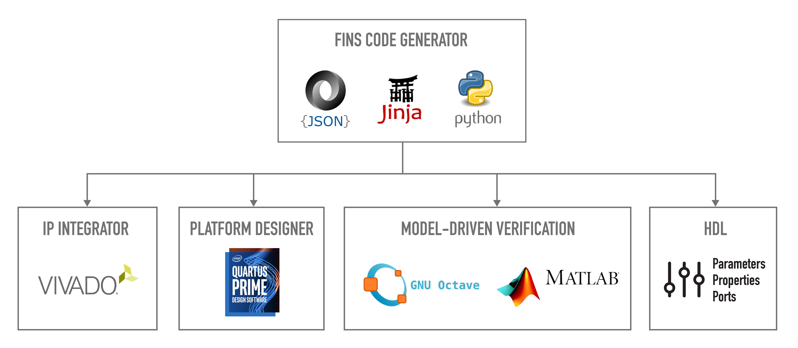

Firmware Intellectual Property (IP) Node Specification (FINS) is an innovative software tool chain from Geon Technologies that defines a programmable logic processing module and automates the firmware design, verification, and integration workflows. The foundation of FINS is the definition of a modular IP (intellectual property) node with a human-readable JSON schema. The schema specification is the launching point for code generators to accelerate embedded systems development. Programmable logic development is automated for the following areas:

1. **IP Build and Simulation Workflows.** TCL and Makefile scripts generated by FINS automate the build and simulation of IP. IP modules can be built for compatibility with Xilinx Vivado IP Integrator or Intel Quartus Platform Designer which enables rapid insertion of IP in platform code and vendor reference designs.
2. **Rapid Reconfiguration.** FINS consolidates parameterization of IP into a single location and distributes these parameters across design tools with code generation of header-like package files.
3. **Properties and Ports Interfaces.** FINS generates HDL source code for a properties interface that enables repeatable software control of firmware and for a ports interface that standardizes firmware to firmware movement of data.



## License

The license for FINS source code is LGPLv3.0, but code generated by FINS does not assume this license. Generated code can be explicitly defined as proprietary when setting the `license_file` key of the FINS JSON file.

## Prerequisites

Core JSON processing and file generation require Python 3.6 or newer. Installing
the package with `pip` also installs Jinja2.

The generated build and simulation workflows have additional, optional
requirements:

* GNU Make to run generated Makefiles.
* Xilinx Vivado and/or Intel Quartus Prime Pro for the selected vendor flow.
* GNU Octave and/or MathWorks MATLAB only for projects whose scripts use the
  generated MATLAB/Octave helpers.

### CI-Tested FPGA Tool Versions

| Toolchain | CI-tested versions | Simulator |
| --------- | ------------------ | --------- |
| Xilinx Vivado | 2022.2, 2025.1.1 | XSim |
| Intel Quartus Prime Pro | 19.4 | Bundled Intel ModelSim |

These versions are exercised by the GitLab CI vendor-tool jobs. Other versions
may work, but they are not currently verified by CI.

## Installation

> NOTE: You may need to upgrade your version of pip and setuptools before installing FINS. To perform this upgrade, execute the command: `sudo python3 -m pip install --upgrade pip setuptools`.

### Install Fins:

```bash
cd fins/
# Install the FINS software and "core" generator:
python3 -m pip install .
# Install the "vivado" generator plugin:
python3 -m pip install ./vivado
# Install the "quartus" generator plugin:
python3 -m pip install ./quartus
```

### Enable `fins` in your `PATH`:

```bash
export PATH=$PATH:/home/$USER/.local/bin
```

See the [FINS Command-Line Reference](docs/cli.md) for all executable options,
backend selection, and multi-file generation.

### Enable Quartus or Vivado

> NOTE: The examples below assume Vivado **and/or** Quartus is installed in the `/opt` directory.  
> NOTE: Only a single tool needs to be setup.  

#### Vivado setup

```bash
source /opt/Xilinx/Vivado/2022.2/settings64.sh
```

#### Quartus setup

```bash
export QUARTUS_ROOTDIR=/opt/intelFPGA_pro/19.4/quartus
export PATH="$PATH:$QUARTUS_ROOTDIR/bin:$QUARTUS_ROOTDIR/sopc_builder/bin:$QUARTUS_ROOTDIR/../modelsim_ase/bin:"
```

### Test Installation

See [Manual FINS Testing](docs/testing.md) for Node, Application, and System
generation, build, and simulation procedures.

### Generate Both Backends

Generate Vivado and Quartus artifacts together when the same Node or
Application must be delivered for both vendors:

```bash
fins -b all fins.json
make vivado
make quartus
make sim-vivado
make sim-quartus
```

The generated top-level Makefile dispatches each target to its vendor-specific
Makefile. Use `BACKEND=vivado` or `BACKEND=quartus` with the traditional
`make` and `make sim` targets when selecting the backend dynamically.

Batch-mode build and simulation logs are stored under a vendor-specific
directory in the Node or Application root:

| Flow | Vivado logs | Quartus logs |
| ---- | ----------- | ------------ |
| Node build | `log/vivado/ip_create.log` | `log/quartus/ip_project.log` and `log/quartus/ip_create.log` |
| Node simulation | `log/vivado/ip_simulate.log` | `log/quartus/ip_simulate.log` |
| Application build | `log/vivado/application_create.log` | `log/quartus/application_project.log` and `log/quartus/application_create.log` |
| Application simulation | `log/vivado/application_simulate.log` | `log/quartus/application_simulate.log` |

### To Uninstall:

> NOTE: You may not have permissions to run these `python3 -m pip` commands. To resolve this you can either use a python virtual environment, the `--user` option, or `sudo`.

```bash
python3 -m pip uninstall fins fins-quartus fins-vivado
```

## Learning FINS

A FINS "**Node**" is a single modular, reusable firmware Intellectual Property (IP). A Node serves as the foundation of FINS. See the link below for more information on development of a "Node".

* [Node Development](./docs/development.md)

To follow a tutorial on how to create a simple "power_converter" FINS Node, see the link below.

* [Power Converter Tutorial](./docs/tutorial1.md)

See the links below for detailed documentation on elements of a FINS Node.

* [Node Parameters](./docs/parameters.md)
* [Node Properties](./docs/properties.md)
* [Node Ports](./docs/ports.md)
* [Node Filesets](./docs/filesets.md)
* [Node Sub-IP](./docs/sub-ip.md)

There are two important FINS constructs used for integration: [**Applications**](./docs/applications.md) and [**Systems**](./docs/systems.md). These are elaborated on in [FINS Integration](./docs/integration.md), but to get started follow the tutorial on how to create a simple "power_application" FINS Application.

* [Power Converter Application Tutorial](./docs/tutorial2.md)

## Notes

Here are a few things to keep in mind when developing FINS IP:
* Xilinx's AXI Interconnect only supports 32bit data widths for AXI4-Lite, but Intel's AXI Interconnect supports both 32bit and 64bit data widths of the AXI4-Lite standard.
* Xilinx's AXI Interconnect creates slave AXI4-Lite byte-indexed buses, whereas Intel's AXI Interconnect creates slave AXI4-Lite word-indexed buses.
* FINS currently generates only VHDL for all HDL code. Verilog user code may require a translation layer of properties and ports records.
* When switching between vendors, you will need to change the part specified in the FINS Node JSON file. You may also find it convenient to specify a top-level FINS parameter to define the vendor that can be used in the HDL in "generate" statements.
* The "quartus" backend does not support a Verilog file as its top-level source file.
* No directory paths should have spaces. For example, `/home/user/Documents/project 1/` is invalid.

The AXI4-Lite buses and AXI4-Stream buses used in the top-level source file have strict requirements for their signals used and their naming. Every bus must have both clock and reset with signal names `aclk` and `aresetn`, respectively. The naming conventions are listed below.

* AXI4-Lite: `["m" or "s"][OPTIONAL_DECIMAL_NUMBER]_axi_[OPTIONAL_BUS_NAME]_[SIGNAL_NAME]`
* AXI4-Stream: `["m" or "s"][OPTIONAL_DECIMAL_NUMBER]_axis_[PORT_NAME]_[SIGNAL_NAME]`

## Contributing to FINS

To develop FINS templates or Python code, it is strongly recommended to use a virtual environment with an "editable" install:

```bash
cd fins/
python3 -m pip install virtualenv
python3 -m venv env
source env/bin/activate
python3 -m pip install -e .
python3 -m pip install -e ./vivado
python3 -m pip install -e ./quartus
```

## Testing Changes to FINS

The test suite covers FINS Nodes, Applications, Systems, and generated vendor
artifacts.

> NOTE: Append `UseGui=1` to a simulation target to run it in GUI mode, for
> example `make sim-vivado UseGui=1` or `make sim-quartus UseGui=1`.

See [Manual FINS Testing](docs/testing.md) for the detailed Node, Application,
and System build and simulation procedures.

### GUI and Primitive Node Simulation

FINS supports GUI simulation for packaged Nodes, Applications, and primitive
Nodes. A primitive Node declares `"node_type": "primitive"`; FINS compiles its
HDL and testbench directly instead of creating a vendor IP project.

| Primitive backend | Batch simulation | `UseGui=1` behavior |
| --- | --- | --- |
| Vivado/XSim | Runs the generated verification Tcl script and writes `log/vivado/primitive_simulate.log`. | Opens the elaborated snapshot in the interactive XSim workspace. Run and debug the simulation using the GUI or its Tcl console. |
| Quartus/Questa | Runs with `vsim -c`, executes the generated Tcl script, and writes `log/quartus/primitive_simulate.log`. | Opens Questa without `-c`, executes the generated Tcl script in the GUI, and keeps output on the simulator console instead of redirecting it to a log. |

XSim's `-tclbatch` option is batch-only, so primitive Vivado GUI sessions are
interactive. Questa supports its generated `-do` script in both batch and GUI
modes.

### Fast Multi-Backend Generation Test

Run the Python regression test first to verify core, Vivado, and Quartus file
generation without invoking either FPGA vendor toolchain:

```bash
cd fins/
python3 -m unittest discover -s test \
  -p 'test_multibackend_generation.py' -v
```

The test runs directly from the source tree, generates the Node fixture in a
temporary directory, and checks the
top-level backend dispatcher, vendor Makefiles and log paths, backend-specific
VHDL packages, Quartus interfaces and simulation commands, and recursive
generation for sub-IP. It does not require package installation, Vivado,
Quartus, ModelSim, Questa, Octave, or MATLAB.

### CI Test Scopes and Failure Logs

The shell test runners accept an optional scope so the same focused test used
by CI can be reproduced locally:

```bash
./test/test_core.sh node
./test/test_core.sh application-system
./test/test_core.sh axis-files
./test/test_core.sh tutorials

./test/test_backend.sh vivado node
./test/test_backend.sh quartus application-system
./test/test_backend.sh vivado tutorials

./test/test_multibackend.sh node
./test/test_multibackend.sh application
```

The `node` scope covers both packaged-IP and primitive-Node batch simulation.
The primitive fixture is compiled and executed directly by XSim or
ModelSim/Questa, and the test requires its generated log to report simulation
success.

Omitting the scope runs all scopes supported by that script. Each CI test
command writes its complete console transcript under `ci-debug/` and uploads
it as a downloadable artifact whether the job passes or fails. Core-generation,
vendor-backend, and multi-backend jobs also upload vendor logs and journals,
generated simulation Tcl and Makefiles, selected project-generation files,
tool and runner diagnostics, and the last 200 lines of every discovered tool
log. These diagnostic bundles do not expire automatically. The `test-python`
job likewise uploads non-expiring transcript and coverage artifacts on every
run.
