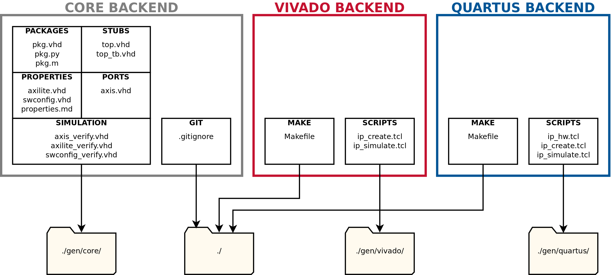
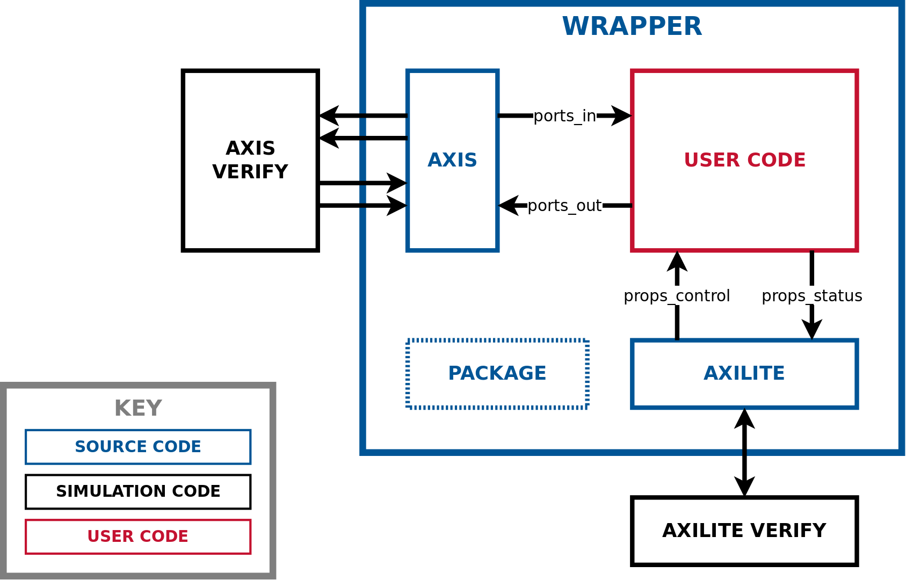
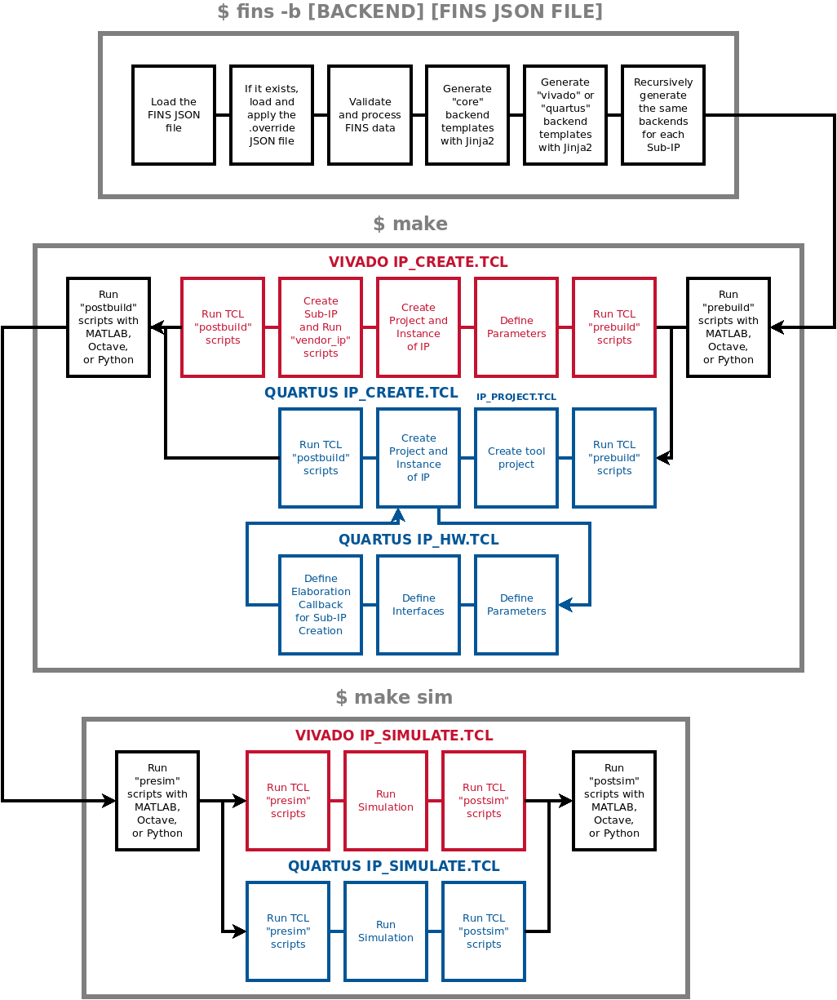

# FINS Node Development

**[RETURN TO TOP LEVEL README](../README.md)**

## Description

Fundamentally, FINS is a code generator that uses a Python-processed JSON specification file as its input. Multiple JSON files may be stored for a single IP, each representing a different "configuration" of the IP. For instance, one configuration may set a specific part that is desired for build and/or test. The code generation was built with a plugin architecture using Python setuptools. Each plugin is referenced as a code generator "backend", and this architecture permits additional backends to be added in the future. FINS generates both source code and vendor-specific automation scripts. The diagram below shows the templates used in each backend and the output directories of each template set.



As the diagram above demonstrates, the "core" backend only generates source code while the "quartus" and "vivado" backends generate automation scripts. The "core" backend is automatically executed when either the "vivado" or "quartus" backend is used. To generate the different backends, use the `fins` executable with the `--backend` (`-b`) switch. The code below demonstrates examples of using FINS to generate the different backends.

```bash
# Generates the "core" backend by default
$ fins fins.json
# Generates the "core" backend explicitly
$ fins --backend core fins.json
# Generates the "core" and "vivado" backends
$ fins -b vivado fins.json
# Generates the "core" and "quartus" backends
$ fins -b quartus fins.json
```

Within the `core` backend, FINS generates the following files under
**./gen/core/**:

* **Populated Node JSON:** FINS writes **`name`.json**, containing the validated
  Node description, resolved parameters, default values, calculated widths and
  offsets, inferred interfaces, and other information used by downstream
  generators and FINS software.

* **Top-Level Code:** For a packaged-IP Node containing ports or properties,
  FINS generates a top-level wrapper (**`name`.vhd**) and testbench
  (**`name`_tb.vhd**). The wrapper connects the generated FINS interfaces to
  the user core. These files may be used as generated or copied into
  user-maintained source when customization is required.

* **User Stub Code:** For a packaged-IP Node containing ports or properties,
  FINS generates **`name`_core.vhd** as a starting point for the user's
  functional HDL. This file exposes the generated port and property records.
  Copy it into a user-maintained source directory before adding custom logic.

* **Package Code:** FINS generates a VHDL package (**`name`_pkg.vhd**) containing
  parameter constants and the record definitions used by ports and properties.
  It also generates Python and Octave/MATLAB packages (**`name`_pkg.py** and
  **`name`_pkg.m**) so build and simulation scripts can use the resolved FINS
  parameters and interface descriptions.

* **Ports Code:** When the Node defines FINS streaming ports, FINS generates an
  AXI4-Stream adapter (**`name`_axis.vhd**) that translates between AXI4-Stream
  signals and the VHDL port records. It also generates the verification module
  **`name`_axis_verify.vhd** and the Octave/MATLAB file helpers
  **`name`_axis_file_read.m** and **`name`_axis_file_write.m** for simulation
  stimulus and result files.

* **Properties Code:** When the Node defines properties, FINS generates the
  AXI4-Lite decoder **`name`_axilite.vhd** and its verification package
  **`name`_axilite_verify.vhd**. It also generates the software-configuration
  decoder **`name`_swconfig.vhd** and verification package
  **`name`_swconfig_verify.vhd**.

* **Property Clock-Domain Crossing Code:** Nodes with properties receive
  **`name`_props_control_cdc.vhd** and **`name`_props_status_cdc.vhd**, together
  with the corresponding Vivado XDC and Quartus SDC constraints
  (**`name`_props_cdc.xdc** and **`name`_props_cdc.sdc**).

* **Property Documentation:** Nodes with properties receive
  **`name`_properties.md**, which describes the properties, and
  **`name`_mem_map.md**, which lists their generated register addresses.

* **Sub-IP Overrides:** When a Node references sub-IP, FINS writes an
  **`.override`** JSON file beside each referenced sub-IP specification. These
  files propagate mapped parameter values and, when applicable, the selected
  FPGA part into recursive generation.

Primitive Nodes intentionally omit the generated top-level wrapper, user core
stub, and testbench because their user HDL and testbench are compiled directly.
The applicable package, port, property, documentation, and support files are
still generated.

Node parameters marked `promote_to_generic: true` are also emitted as
top-level HDL generics (or Verilog parameters) with the declared `hdl_type`.
The generated wrapper maps each value into the user-core instance, and the
Vivado and Quartus backends expose the promoted values through their IP
customization controls. Package constants remain available for source
compatibility. A user-maintained core must declare matching generics when it
consumes a promoted value. Promotion does not apply automatically to
Application or System parameters.

The code generated by the "core" backend fits together as shown in the diagram below.



The "quartus" and "vivado" backends automate the build and simulation of a FINS Node for rapid integration into Intel Quartus Platform Designer and Xilinx Vivado IP Integrator, respectively. The auto-generated TCL scripts are called by the auto-generated **Makefile** with the following targets:

> NOTE: When running the `make` command, you have the option of viewing the console output and watching the GUI-based tools execute the scripts. To use this mode in the IP build and simulation process, set the "UseGui" make variable to 1 like this: `make sim UseGui=1`. Note that in this mode the developer will need to close the GUI-based tool windows to proceed at different steps during the process.

* `all`: (Default) Builds and packages the intellectual property
* `sim`: Runs the simulation and depends on `all`. Packaged-IP Nodes receive
  this target when a simulation fileset is present; primitive-Node Makefiles
  provide the direct simulation target.
* `clean`: Deletes all temporary and project files for this repository only
* `clean-all`: Deletes all temporary and project files for this repository and all sub-IP repositories

The following diagram shows the sequence of operations that takes place when running the FINS code generation and then executing the `make` targets.



## Workflow

Start a FINS Node JSON file with its required `name` and whichever optional
`params`, `ports`, and `properties` definitions the Node needs. These fields
drive the generated interfaces and packages.

1. The top-level schema of a FINS Node JSON file is located in the [section below](#json-schema).
2. Choose a unique and descriptive value for the `name` key.
3. The `params` key contains configuration values propagated throughout the
   generated design. Node parameters can optionally be promoted to top-level
   HDL generics; Application and System parameters are propagated as
   constants. The schema is documented [here](parameters.md).
4. The `ports` key defines the data and metadata interfaces that will be connected to other FINS Nodes. The `ports` schema is located [here](ports.md).
5. The `properties` key defines the software control interface. The `properties` schema is located [here](properties.md).

The next step is to generate the "core" backend for the FINS Node. Make sure you have [installed FINS](../README.md#installation)! Run the following command to generate the "core" backend.

> NOTE: This workflow is assuming that your FINS Node JSON is called **fins.json**. The value of the `name` top-level key of the FINS Node JSON file will be referenced with `name`.

```bash
$ fins fins.json
```

The code generation output of the "core" backend will be located in the **./gen/core/** directory. Browse this directory to notice the files described in the [section above](#description). The one file in particular that we are interested in is the **`name`_core.vhd** file, which is the user core code stub - i.e. the place for your functional HDL code. Execute the commands below to copy this user core code stub into a folder that will contain all manually maintained HDL code.

```bash
$ mkdir hdl
$ cp ./gen/core/`name`_core.vhd ./hdl/
```

By copying this code out of the **./gen/core/** directory, you are transferring "ownership" of this file to yourself. It will no longer automatically update when you change the **fins.json** file and re-run the `fins` code generator so that your user code is preserved. The record interfaces, however, will update with code generation changes to the **./gen/core/`name`_pkg.vhd** file. If you have special interface requirements for your firmware IP (meaning you need HDL ports other than the standard AXI4-Lite properties interface or the AXI4-Stream ports interfaces), you will also need to copy and "own" the top-level wrapper **./gen/core/`name`.vhd** file and the top-level testbench **./gen/core/`name`_tb.vhd** files.

Develop your user core code in the **./hdl/`name`_core.vhd** file, interacting with the FINS Ports and Properties record interfaces. The `ports_in` and `ports_out` record interfaces are described in detail [here](ports.md#fins-port-records). The `props_control` and `props_status` record interfaces are described in detail [here](properties.md#property-records). If you have an existing HDL module, you will need to instantiate this module in the user core and then translate the record interfaces to the HDL ports of your module.

Once your code files are in place (all development doesn't have to be finished!), the next step is to define the top-level key `filesets` in the FINS Node JSON file. Defining the `filesets` key enables the Xilinx Vivado/Intel Quartus project creation and simulation execution flows. The `filesets` key is explained in detail [here](filesets.md), but a few special notes are below:

1. Intel Quartus requires source files to be in the correct compile order.
2. Vendor IP cores are best created with a TCL script, and this TCL script should be added to the `filesets::scripts::vendor_ip` key. Any TCL scripts appearing in this key will be sourced within the IP creation script, and the script will have access to any Parameters defined in the `params` key of the FINS Node JSON file.
3. If files are defined in the `filesets::source` key, they do not have to be added to the `filesets::sim` key as well. The `filesets::sim` key is for simulation-only files.
4. Auto-generated code must be manually added to the `filesets::source` and `filesets::sim` keys. FINS does not assume that the auto-generated code will be a part of your project, so make sure you add the files you need from `./gen/core/`!
5. The `filesets::scripts::presim` key is a good place to add scripts that create simulation input ("sim_source") files. The `filesets::scripts::postsim` key is a good place to add scripts that validate simulation output ("sim_sink") files. These scripts should source the **`name`_pkg.m** and **`name`_pkg.py** package files to take advantage of auto-generated Parameter, Property, and Port specifications. The package files themselves should not be listed in the `filesets` key.
6. The `filesets::scripts::prebuild` key is a good place to add scripts that create coefficient or RAM initialization files.

With the `filesets` key defined, you may now build and simulate your design. Follow the commands below as an example of generating the Xilinx Vivado backend and then building the IP.

```bash
$ fins -b vivado fins.json
$ make
```

By default, the **Makefile** targets will use a command line flow and store their output to corresponding files in the **./log/** directory. If you would like to view the command output in the terminal window and execute the flow using the GUIs, set the `UseGui` make variable like this: `make sim UseGui=1`.

If there are errors in your `params`, `ports`, or `properties` top-level keys, regenerate the code with the core backend like this: `fins fins.json`. The Xilinx Vivado projects will be automatically updated, but Intel Quartus projects may need to be regenerated with the `make` command. If there are errors in your `filesets` top-level key, the project should be regenerated with the `make clean` and the `make` commands.

## JSON Schema

The JSON schema for FINS Node is composed of the following top-level fields:

| Key             | Type   | Required | Default Value | Description |
| --------------- | ------ | -------- | ------------- | ----------- |
| name            | string | YES      |               | The name of the IP. |
| node_type       | string | NO       | `ip`          | The Node implementation type: `ip` uses the packaged-IP build flow, while `primitive` compiles and simulates the Node's HDL directly. Primitive Nodes cannot contain packaged sub-IP in the `ip` field. |
| description     | string | NO       |               | The description of the IP. |
| version         | string | NO       | 1.0.0         | The version of the IP. |
| company_name    | string | NO       |               | The name of the company which created the IP. |
| company_url     | string | NO       | user.org      | The base URL of the company which created the IP. Quartus uses this field as the AUTHOR. |
| company_logo    | string | NO       |               | The relative filepath of the logo image to use for display purposes. |
| license_file    | string | NO       |               | The relative filepath of the license file containing the string to be inserted in all files generated by FINS. |
| library         | string | NO       | user          | The name of the category or group of which this IP belongs. |
| user_ip_catalog | string | NO       |               | A directory location where third-party sub-IP is stored, meaning only sub-IP that were not already explicitly referenced in the FINS `ip` key. |
| part            | string | NO       |               | The programmable logic part number. While a default is not selected for the JSON, the auto-generated vendor scripts use the following default parts: Vivado uses the Zynq WebPACK part **xc7z020clg484-1** and Quartus uses the Cyclone V **10CX220YF780I5G**. |
| parts           | dict   | NO       |               | Vendor-specific programmable logic parts, keyed by `vivado` and `quartus`. These values are used when `part` is omitted. |
| top_source      | string | NO       | `name`        | The name of the top-level synthesizable source HDL module. For Quartus, this field **MUST** be the same as the top-level source HDL's filename without the extension. |
| top_sim         | string | NO       | `name`_tb     | The name of the top-level testbench simulation HDL module. For Quartus, this field **MUST** be the same as the top-level testbench HDL's filename without the extension. |
| params          | dict[] | NO       |               | An array of parameter definitions. See the parameters documentation [here](parameters.md). |
| filesets        | dict   | NO       |               | A dictionary of fileset definitions. See the filesets documentation [here](filesets.md). |
| ip              | dict[] | NO       |               | An array of sub-IP references. See the sub-IP documentation [here](sub-ip.md). |
| ports           | dict   | NO       |               | A dictionary of ports definitions. See the ports documentation [here](ports.md). |
| properties      | dict   | NO       |               | A dictionary of properties definitions. See the properties documentation [here](properties.md). |

## Integration of Multiple FINS IPs and a Platform
FINS Applications and Systems are used for integration of multiple FINS Nodes and a platform. See [FINS Integration](integration.md) for more information.

**[RETURN TO TOP LEVEL README](../README.md)**
