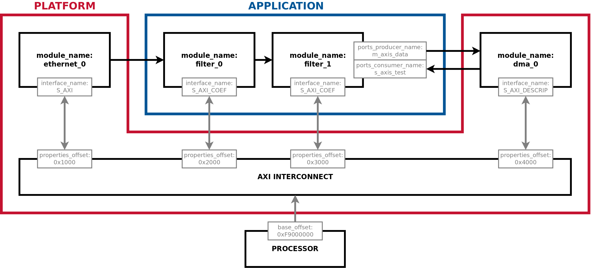

# FINS Systems Development

## Introduction
The FINS System JSON is used to aggregate the Node information so that the FINS software package may control properties and communicate with ports in the programmable logic build.

Illustrating the FINS System construct, the diagram below depicts a programmable logic block design that gets built into a bitstream. A System is used to describe the design in its entirety. The labeled information is required for software control and data communication with a processor, and this information is defined in the [FINS System JSON Schema](#system-json-schema).



## Description

Systems are used to describe and expose the contents of an existing programmable-logic design to enable software communication to properties and ports. In particular, a System generally describes the contents of a programmable-logic block design or HDL design. The block design tool is IP Integrator for Xilinx Vivado and Platform Designer for Intel Quartus. Reference the Intel and Xilinx user guides for the step-by-step details of creating new block designs.

More explicitly, FINS Systems tell software what address offsets to use for each IP/Node in the programmable-logic design. Additionally, they inform software as to which ports in the design communicate data to/from the processor via DMA. The primary output is the populated System JSON under **./gen/core/**, retaining the input filename. FINS Software uses this information to describe the contents of a bitstream.

FINS does not generate the complete System HDL or block design. When a DMA
producer or consumer port is selected, however, it generates both AXI4-Stream
and Avalon-ST width-conversion adapter VHDL and JSON, plus the producer FIFO
Tcl scripts.

| Condition | Core outputs |
| --------- | ------------ |
| Every System | Populated JSON retaining the input filename, plus `params.tcl` |
| `ports_producer_name` selected | AXI4-Stream and Avalon-ST parallel-to-TDM adapter directories containing VHDL and Node JSON; each also includes `parallel_word_fifo.tcl` |
| `ports_consumer_name` selected | AXI4-Stream and Avalon-ST TDM-to-parallel adapter directories containing VHDL and Node JSON |

## Workflow

The first step in developing a FINS System is to integrate any Application code with a "Platform". A Platform is a set of HDL code or a block design that is responsible for interacting with the hardware interfaces on the target circuit board. Platforms are often provided by the vendors as reference designs or I/O wrappers. A robust Platform has standard interfaces to interact with Application modules.

Once you have a bitstream that integrates Application content with a Platform, you are ready to develop a FINS System JSON file. The details of the FINS System JSON schema are in the [section below](#system-json-schema).

To get started developing a FINS System, create a JSON file with the following:

1. A unique and descriptive value for the `name` key.
2. The optional `params` key contains constants that can be used elsewhere in the JSON file. Its schema is documented [here](parameters.md).
3. The `nodes` key lists the IPs and Nodes which are being described by this System. See the [Nodes JSON section](#system-json-schema-nodes) for more information.
4. The `base_offset` key is the global offset for the bus that controls the AXI4-Lite Properties interface. For many architectures this is 0, but some specify this base address at the bus level.
5. For each Node that exposes properties, set `properties_offset` to either its numeric base address or the filepath of a `.bd` or `.qsys` design from which FINS can infer the address. These Nodes must also specify the corresponding AXI4-Lite `interface_name`.
6. The `ports_consumer_name` key is set for the element of the `nodes` array that consumes data from a processor through a DMA module. At most one element of the `nodes` array can have this key set.
7. The `ports_producer_name` key is set for the element of the `nodes` array that produces data to a processor through a DMA module. At most one element of the `nodes` array can have this key set.

The `fins` executable is used with the FINS System to run code generation. The standard "core" backend location is **./gen/core/**. The `fins` executable automatically detects differences in FINS System schemas. To generate the FINS System, execute the following commands:

> NOTE: This example assumes your FINS System JSON file is called **system.json**.

```bash
$ fins system.json
```

For an input named `system.json`, the populated output is
**./gen/core/system.json**. Copy or rename that output to
**/etc/fins/nodeset.json** on the target hardware host; this is the default
location used by FINS Software.

## System JSON Schema

The JSON schema for a FINS System is composed of the following top-level fields:

| Key               | Type   | Required | Default Value | Description |
| ----------------- | ------ | -------- | ------------- | ----------- |
| name              | string | YES      |               | The name of the System |
| description       | string | NO       |               | The description of the System |
| version           | string | NO       | 1.0.0         | The version of the System |
| company_name      | string | NO       |               | The name of the company which created the System |
| company_url       | string | NO       | user.org      | The base URL of the company which created the System. Quartus uses this field as the AUTHOR. |
| company_logo      | string | NO       |               | The relative filepath of the logo image to use for display purposes. |
| license_file      | string | NO       |               | The relative filepath of the license file containing the string to be inserted in all files generated by FINS. |
| base_offset       | uint   | NO       |             0 | The base address offset of the bus used to communicate with the FINS nodes. |
| params            | dict[] | NO       |               | An array of parameter definitions. See the parameters documentation [here](parameters.md). |
| nodes             | dict[] | YES      |               | A dictionary array that contains a description of each node. See [Nodes JSON section](#system-json-schema-nodes). |

An example of a FINS System JSON file can be found [here](../test/system/quartus_system_test.json).


## System JSON Schema: Nodes
Each dictionary element of the `nodes` array has the following fields:

| Key                 | Type              | Mode | Required | Default Value | Description |
| ------------------- | ----------------- | ---- | -------- | ------------- | ----------- |
| fins_path           | string            | BOTH | YES      |               | The path to the *generated* FINS Node JSON file of the IP node. |
| module_name         | string            | BOTH | YES      |               | The name of this module when instantiated in the Block Design. |
| interface_name      | string            | BOTH | WHEN PROPERTIES |               | Required when the referenced Node exposes properties. The name of its AXI4-Lite properties interface. This identifies the Node interface and is used when inferring an address from a block design. |
| properties_offset   | uint -OR- string  | SYS  | WHEN PROPERTIES |               | Required when the referenced Node exposes properties. Use a numeric base address or a path ending in `.qsys` or `.bd` to infer the address from an Intel Platform Designer or Vivado IP Integrator design. |
| ports_producer_name | string            | SYS  | NO       |               | The name of an output FINS port on the referenced Node that sends data to the processor through a DMA module. |
| ports_consumer_name | string            | SYS  | NO       |               | The name of an input FINS port on the referenced Node that receives data from the processor through a DMA module. |

**[RETURN TO TOP LEVEL README](../README.md)**
