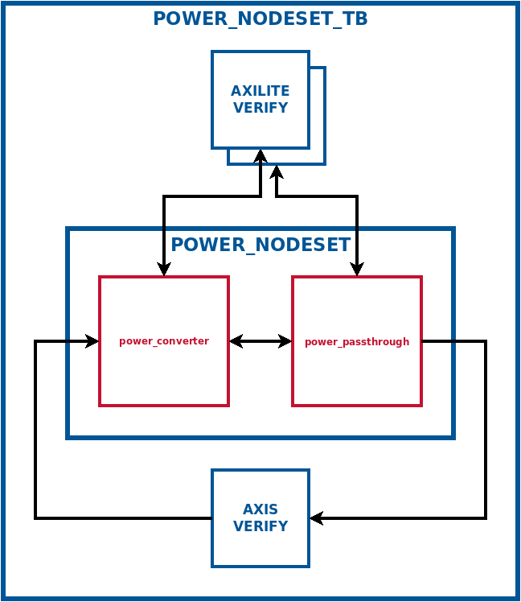
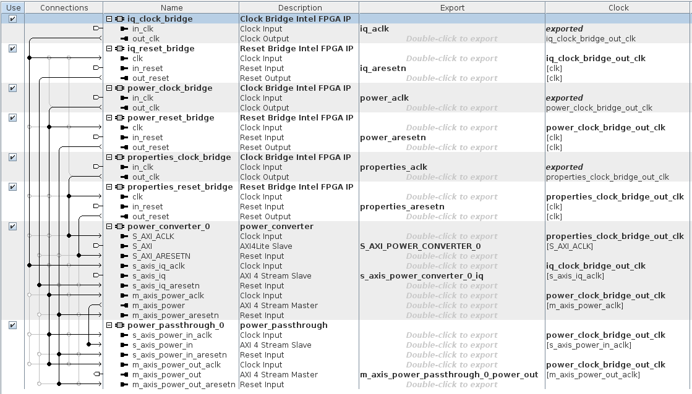
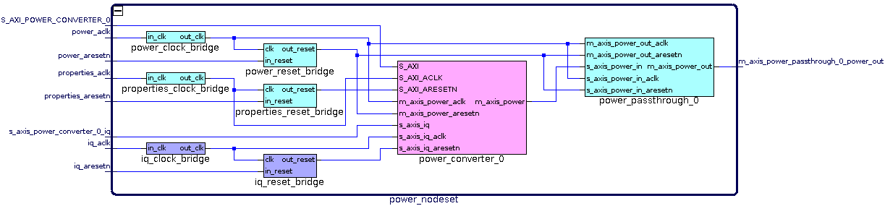

# Tutorial: FINS Application - Power Converter

**[RETURN TO TOP LEVEL README](../README.md)**

In this tutorial, we will build on the work done in
[Tutorial: FINS Node Power Converter](tutorial1.md) to create a simple FINS
Application containing the Power Converter Node and a basic Passthrough Node.
We will generate, build, and simulate the Application with both Xilinx Vivado
and Intel Quartus Prime Pro. Make sure you have installed `fins`,
`fins-vivado`, and `fins-quartus`, and that you have completed the
[first tutorial](tutorial1.md). See the
[CI-tested FPGA tool versions](../README.md#ci-tested-fpga-tool-versions) for
the versions currently exercised by automated testing.

## Step 1: Copy the Passthrough Node into your workspace

Copy **tutorials/power_passthrough** to the same directory that contains your new **power_converter** node.
```bash
$ cp <path-to-fins>/tutorials/power_passthrough/ .
```

Your top-level directory structure should look roughly as follows:
```bash
$ tree -L 1
├── power_converter
└── power_passthrough
```

## Step 2: Creating the FINS Application Specification JSON File

Create a new directory called **power_application** in the same directory where you created **power_converter** and **power_passthrough**. All filepaths for the rest of this tutorial will be relative to this directory, and it will be referenced as the "Application root" directory.

```bash
$ mkdir power_application
$ cd power_application
```

Using your favorite text editor, create a file called **fins.json** in the **power_application** directory with the following contents.

```json
{
  "name":"power_application",
  "is_application":true,
  "params": [
    { "name":"IQ_DATA_WIDTH",    "value":32 },
    { "name":"POWER_DATA_WIDTH", "value":16 }
  ],
  "nodes":[
    {
      "fins_path":"../power_converter/fins.json",
      "module_name":"power_converter_0",
      "params": [
        { "name":"IQ_DATA_WIDTH",         "parent": "IQ_DATA_WIDTH" },
        { "name":"POWER_DATA_WIDTH",      "parent": "POWER_DATA_WIDTH" }
      ]
    },
    {
      "fins_path":"../power_passthrough/fins.json",
      "module_name":"power_passthrough_0",
      "params": [
        { "name":"POWER_DATA_WIDTH", "parent": "POWER_DATA_WIDTH" }
      ]
    }
  ],
  "connections":[
    {
      "source":{"node_name":"power_converter_0", "net":"power"},
      "destinations":[
        {"node_name":"power_passthrough_0", "net":"power_in"}
      ]
    }
  ],
  "clocks":[
    {
      "clock":"iq",
      "nets":[
        {"node_name":"power_converter_0",   "net":"iq"}
      ]
    },
    {
      "clock":"power",
      "nets":[
        {"node_name":"power_converter_0",   "net":"power"},
        {"node_name":"power_passthrough_0", "net":"power_in"},
        {"node_name":"power_passthrough_0", "net":"power_out"}
      ]
    }
  ]
}
```

In the **fins.json** file we just created, we have defined:
1. Two "params" which override params of the Nodes in this Application. See [here](parameters.md) for more information about parameters.
2. A list of FINS "nodes" to be instantiated and connected in this Application. Each Node is assigned a meaningful module name, and Node parameters are overwritten by parameters of the Application. FINS code-generation instantiates the nodes listed here in a backend/tool-specific block design (Vivado Block Design or Quartus Platform Designer System). For more information on the fields of each "nodes" entry see [here](applications.md#application-json-schema-nodes).
3. Connections between Node ports. For more information on "connections" see [here](applications.md#application-json-schema-connections).
4. Clock domains and their assignments to ports. For more information on "clocks" see [here](applications.md#application-json-schema-clocks).

## Step 3: Generating the Vendor-Neutral Application Files

Generate the common Application HDL and testbench files using the core backend:

```bash
$ fins fins.json
```

Once that operation completes, inspect the **./gen/core** directory to find the files listed below.
* **power_application.json**: This is the implemented FINS Application JSON data used to generate the templates, and it has all default values set and parameter names converted to literal values. It is a good place to check to make sure that the **fins.json** file that you wrote is getting interpreted properly.
* **power_application_axis_verify.vhd**: This is a testbench module that reads and writes files with AXI4-Stream bus data.
* **power_application_tb.vhd**: This is a simple default testbench that verifies the ports and properties interfaces.

## Step 4: Adding the Filesets

Modify your **fins.json** file to add the following code after the `connections` top-level key. Remember to use a comma after the closing square brace (`]`) of `connections`!

```json
  "filesets":{
    "sim":[
      { "path":"../power_converter/gen/core/power_converter_axilite_verify.vhd" },
      { "path":"./gen/core/power_application_pkg.vhd" },
      { "path":"./gen/core/power_application_axis_verify.vhd" },
      { "path":"./gen/core/power_application_tb.vhd" }
    ],
    "scripts":{
      "postsim":[
        { "path":"scripts/verify_sim.py" }
      ]
    }
  }
```

The `filesets` top-level key indicates which files are used in the Application project. For Applications in particular, HDL files can only be added for simulation purposes. Notice that a few of the files are located in the **gen/core/** directory. These files are auto-generated and accordingly updated with the `fins` code generator executable. Since FINS manages these files, the burden of creating and maintaining these files is removed from the developer!

A few files pointed to here are from the Nodes in this Application. They are for property access and verification, and provide other utility in the Application testbench.

The following diagram illustrates how the Application block design connects to the generated testbench for verification.


### Copy simulation files into the application

First we need to create a data-source file called **sim_source_power_converter_0_iq.txt**. This will drive the "iq" input port of the **power_converter** node. This filename matches the default used in the testbench VHDL and is derived from the Node's `module_name` in **fins.json**.

Create a directory **./sim_data** in the Application root to contain our simulation files. **./sim_data** is the generated testbench's default location for source/sink files. Since this Application is just a **power_converter** Node connected to a passthrough Node, just copy over the simulation data from the **power_converter** tutorial.

```bash
$ mkdir sim_data
$ cp ../power_converter/sim_data/sim_source_iq.txt sim_data/sim_source_power_converter_0_iq.txt
```

We now create a verification script with contents nearly identical to that of the **power_converter** tutorial except for the imported module name and source/sink filenames.

```bash
$ mkdir scripts
```

Within the **scripts** directory, create a file called **verify_sim.py** with the contents below.

```python
#!/usr/bin/env python3
import sys

# Import auto-generated parameters file
sys.path.append('gen/core/')
import power_application_pkg

# Open our simulation input
sim_source_data = {'last':[], 'data':{'i':[], 'q':[]} }
with open('sim_data/sim_source_power_converter_0_iq.txt', 'r') as sim_source_file:
    for sim_source_line in sim_source_file:
        line_data = sim_source_line.split(' ')
        sim_source_data['last'].append(int(line_data[0], 16))
        sim_source_data['data']['q'].append(int(line_data[1][0:4], 16))
        sim_source_data['data']['i'].append(int(line_data[1][4:8], 16))

# Open our simulation output
sim_sink_data = {'last':[], 'data':[]}
with open('sim_data/sim_sink_power_passthrough_0_power_out.txt', 'r') as sim_sink_file:
    for sim_sink_line in sim_sink_file:
        line_data = sim_sink_line.split(' ')
        sim_sink_data['last'].append(int(line_data[0], 16))
        sim_sink_data['data'].append(int(line_data[1], 16))

# Implement the algorithm
sim_expected_data = []
for ix in range(len(sim_source_data['data']['i'])):
    sim_expected_data.append(sim_source_data['data']['i'][ix]**2 + sim_source_data['data']['q'][ix]**2)

if sim_expected_data == sim_sink_data['data']:
    print('PASS: power simulation data is correct')
else:
    print('ERROR: power simulation data is incorrect')
    print('    * Expected: {}'.format(sim_expected_data))
    print('    * Received: {}'.format(sim_sink_data['data']))
    sys.exit(1)
```

We can tell FINS to add this script to the simulation process by adding it to the **fins.json** file. Modify your **fins.json** file to add the following code inside the `filesets` top-level key. Remember to use a comma after the closing curly brace (`}`) of `sim`!

```json
    "scripts":{
      "postsim":[
        { "path":"scripts/verify_sim.py" }
      ]
    }
```

This script is referenced as `postsim` in the JSON's `filesets`, so it will run _after_ simulation completes.

## Step 5: Building the Application with Vivado and Quartus

Generate the common files and both supported vendor backends:

```bash
$ fins -b all fins.json
```

The generated vendor directories contain the scripts needed to create each
project:

* **gen/vivado/application_create.tcl**: Creates the Vivado project and block
  design, instantiates and connects the Nodes, exports open interfaces, and
  connects clocks and resets.
* **gen/vivado/application_simulate.tcl**: Configures and runs the XSim
  simulation.
* **gen/quartus/application_project.tcl**: Creates the Quartus project.
* **gen/quartus/application_create.tcl**: Creates the Platform Designer system,
  instantiates and connects the Nodes, exports open interfaces, and connects
  clocks and resets.
* **gen/quartus/application_simulate.tcl**: Configures and runs the ModelSim
  simulation.

To create and open the Vivado project, execute:

> NOTE: Make sure you have sourced the **settings64.sh** script for the version
> of Xilinx Vivado that you want to use.

```bash
$ make vivado UseGui=1
```

The Vivado project is written to:

```text
project/vivado/power_application.xpr
```

To create the Quartus project and Platform Designer system, execute:

> NOTE: Make sure you have the path to the `quartus` executable on your `PATH` environmental variable for the version of Intel Quartus that you want to use.

```bash
$ make quartus UseGui=1
```

The Quartus project and Platform Designer system are written to:

```text
project/quartus/power_application.qpf
project/quartus/power_application.qsys
```

The `UseGui=1` make variable launches the Vivado GUI for the Vivado build and
displays Quartus messages in the command window for the Quartus build. Since
Quartus uses a command-line flow here, its GUI is not opened automatically.

You can also open either generated project directly:

```bash
$ vivado project/vivado/power_application.xpr
$ qsys-edit --quartus_project=project/quartus/power_application.qpf \
    project/quartus/power_application.qsys
```

The following screenshots show the Quartus Platform Designer view. Vivado
represents the same Nodes and connections in its block design.




## Step 6: Simulating the Application with XSim and ModelSim

Run the Vivado XSim simulation with the GUI:

> NOTE: This command assumes that you have followed this tutorial exactly and the results of the previous steps are located in the repository.

```bash
$ make sim-vivado UseGui=1
```

Run the Quartus ModelSim simulation with the GUI:

```bash
$ make sim-quartus UseGui=1
```

Both simulations run the generated testbench and the post-simulation
verification script. A successful run reports `***** SIMULATION PASSED *****`.

For unattended operation, omit `UseGui=1`:

```bash
$ make sim-vivado
$ make sim-quartus
```

Batch-mode output, including the result of the Python verification script, is
written to **log/vivado/application_simulate.log** and
**log/quartus/application_simulate.log**. Verify that both commands complete
without error and that both logs report a passing simulation.

## Solution

The solution files for this tutorial are located in the **tutorials/power_application** directory of the FINS repository.

**[RETURN TO TOP LEVEL README](../README.md)**
